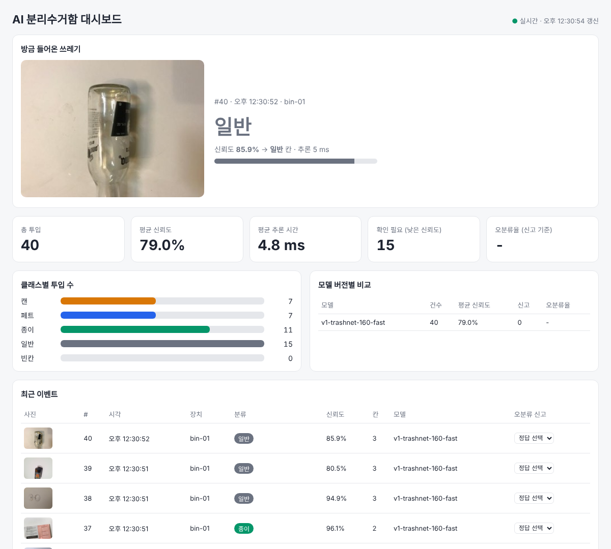
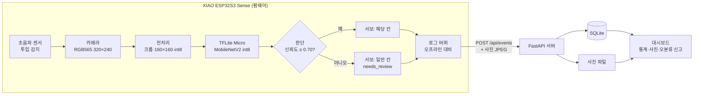

# AI 스마트 분리수거함 (ai-recycle-bin)

ESP32-S3가 **기기 안에서(온디바이스)** 쓰레기를 분류(캔/페트/종이/일반)하고, 서보모터로 해당 칸에 넣은 뒤
분류 로그와 사진을 서버 DB에 저장하는 피지컬 AI 프로젝트.


> **현재 상태**: 소프트웨어(모델·펌웨어·서버·DB·대시보드·CI)는 완성했고, 모두 CI로 검증해요.
> ESP32 보드 없이 개발해서 **실제 보드 동작(카메라·서보·추론 속도)은 아직 측정 전**이에요.
> 대신 ① 펌웨어를 ESP32용으로 컴파일하고, ② 펌웨어와 같은 C++ 추론 코드를 PC에서 test 세트로 실행하고,
> ③ 가짜 장치가 실제 모델로 분류한 결과를 서버에 보내는 방식으로 검증했어요.



*대시보드: 가짜 장치(`tools/fake_device.py --use-model`)가 학습한 int8 모델로 테스트 사진을 분류해 보낸 화면.
추론 시간은 PC 기준이에요.*

## 필수 조건과 검증 방법

| 조건 | 구현 | 어떻게 확인하나요 |
|---|---|---|
| **ESP32 모델 사용** | TrashNet으로 직접 학습한 MobileNetV2 int8 모델(634KB)을 XIAO ESP32S3 Sense 안에서 **TFLite Micro로 추론**. 사진을 서버로 보내 판단하는 게 아니라 칩이 직접 판단하므로 Wi-Fi 없이도 분류 | CI `Firmware build (tflite-model)`: ESP32용 컴파일 (플래시 55%) · CI `Model accuracy`: 펌웨어 C++ 추론 코드로 test 410장 분류 |
| **로그를 DB에 저장** | ESP32 → HTTP POST → FastAPI → **SQLite**. 분류 결과·신뢰도·추론 시간·모델 버전·사진 저장. Wi-Fi가 끊기면 장치 버퍼(64건)에 쌓았다가 재전송 | CI `E2E`: 가짜 장치가 30% 전송 실패 상황에서 30건 전송 → DB에 30건과 사진이 저장됐는지 확인 |
| **CI 구현** | GitHub Actions 7개 작업 (아래 [CI](#ci) 참고) | [Actions 실행 기록](https://github.com/jihustar12-design/ai-recycle-bin/actions) · 각 실행의 Summary 에 정확도 표와 펌웨어 크기 |

## 시스템 구조



## 모델 성능

TrashNet(Stanford, MIT License) 2,527장을 5개 클래스로 바꿔 학습 1,640장 / **test 410장**으로 평가했어요.
ESP32에 들어가는 **int8 모델 기준**이고, 아래 수치는 CI(`model` 작업)가 매 push마다 test 세트로 직접 측정한 값이에요.
(학습 직후 TensorFlow 기준으로는 81.5% — JPEG 디코더 차이로 1장 정도 달라짐)

| 항목 | 값 |
|---|---|
| **정확도 (int8, ESP32용)** | **81.2%** (333/410, CI 측정) |
| 모델 | MobileNetV2 α0.35 전이학습, 입력 160×160 RGB, **634 KB** |
| 추론 메모리 | 445 KB (PSRAM) |
| 참고: TrashNet 원 논문 CNN | 약 75% (6개 클래스) |

혼동 행렬 (행: 실제, 열: 예측)

| 실제 \ 예측 | can | empty | general | paper | pet |
|---|---|---|---|---|---|
| **can** | 66 | 0 | 11 | 3 | 2 |
| **empty** | 0 | 77 | 0 | 5 | 0 |
| **general** | 7 | 0 | 58 | 9 | 8 |
| **paper** | 2 | 0 | 3 | 77 | 0 |
| **pet** | 2 | 0 | 21 | 4 | 55 |

| 클래스 | 원본 (TrashNet) | 칸 |
|---|---|---|
| can | metal | 0 |
| pet | plastic | 1 |
| paper | paper + cardboard | 2 |
| general | trash + glass (유리 칸이 없어 일반으로) | 3 |
| empty | 사진의 빈 배경을 잘라 합성 | 동작 안 함 |

- 가장 큰 약점은 **페트 → 일반(21장)**: 일반 클래스에 섞인 유리병과 투명 페트병을 헷갈림
- 신뢰도 70% 미만은 일반 칸 + `needs_review`로 기록 → 대시보드에서 사진을 보고 오분류 신고
- **펌웨어 C++ 코드로 PC에서 같은 410장을 분류한 결과**(TFLite Micro): RGB888 82.2%, 카메라 형식 RGB565 78.5%, Python 결과와 예측 97.8% 일치
- 수치는 TrashNet 촬영 환경(흰 배경·밝은 조명) 기준. 실제 상자 안 정확도는 보드 연결 후 측정 예정

데이터셋 생성·학습·평가 방법: [`model/README.md`](model/README.md)

## CI

`.github/workflows/ci.yml` — push 할 때마다 실행

| 작업 | 하는 일 |
|---|---|
| Server (lint + unit test) | ruff + pytest 19개 (이벤트 저장·검증, 사진 업로드, 통계, 오분류 신고, DB 마이그레이션) |
| E2E (fake device → server → DB) | 서버 실행 → 가짜 장치가 30% 전송 실패를 섞어 30건 + 사진 전송 → DB 건수·사진 확인 |
| Firmware logic (host unit test) | 판단 로직·칸 매핑·로그 버퍼·JSON·라벨 매핑을 g++로 테스트 |
| Firmware build × 2 | arduino-cli로 XIAO ESP32S3용 컴파일 (실제 모델 / 가짜 분류기) |
| Model accuracy | TrashNet test 세트 재생성 → 저장소의 int8 모델로 정확도 측정(78% 미만이면 실패) → 펌웨어 C++ 코드 + TFLite Micro로 같은 평가 |
| Docker build | `docker compose build` |

## 데이터베이스 (SQLite)

| 테이블 | 내용 |
|---|---|
| `sort_events` | 투입 1건: 장치, 시각, 라벨, 신뢰도, 추론 시간(ms), 칸, 확인 필요 여부, 펌웨어·모델 버전, 사진 유무 |
| `feedback` | 대시보드에서 신고한 실제 정답 → 오분류율 계산 |
| `device_status` | 장치 상태 주기 보고: Wi-Fi 세기, 남은 메모리, 가동 시간, 미전송 로그 수 |

사진은 `data/images/{이벤트 id}.jpg` 로 저장돼요.

## 실행 (하드웨어 없이)

```bash
git clone https://github.com/jihustar12-design/ai-recycle-bin.git
cd ai-recycle-bin

# 1) 서버 (터미널 1)
cd server
python3 -m venv .venv && source .venv/bin/activate
pip install -r requirements-dev.txt
uvicorn app.main:app --port 8000          # 브라우저: http://localhost:8000  (API 문서: /docs)

# 2) 가짜 장치 (터미널 2, 저장소 루트에서)
source server/.venv/bin/activate
python tools/fake_device.py                         # 샘플 사진 + 무작위 결과
pip install ai-edge-litert numpy pillow             # 실제 모델로 분류하려면 (처음 한 번, Python 3.10~3.12)
python tools/fake_device.py --use-model --interval 3
```

Docker로 서버 실행: `docker compose up --build` (포트 8000)

## 테스트

```bash
cd server && pytest -q && ruff check . ../tools ../model   # 서버
make -C firmware/tests                                       # 펌웨어 판단 로직
python model/prepare_dataset.py && python model/evaluate.py --min-accuracy 0.78   # 모델 정확도
```

## 설계에서 신경 쓴 점

- **온디바이스 추론**: 판단은 칩 안에서 끝나고, 서버는 기록만 받아요. 네트워크가 끊겨도 분류는 계속돼요.
- **학습과 추론의 전처리를 똑같이**: 가운데 크롭 → 160×160 양선형 축소 → int8. Python(`model/evaluate.py`)과 C++(`firmware/smart_bin/preprocess.h`)을 같은 알고리즘으로 만들고 CI에서 결과를 비교해요.
- **라벨 순서 버그 방지**: 모델은 라벨을 알파벳순으로 내보내서, 펌웨어는 순서가 아니라 **이름**으로 매핑해요 (테스트 포함).
- **애매하면 일반 칸으로**: 신뢰도 70% 미만은 재활용 칸을 오염시키지 않도록 일반 칸에 넣고 `needs_review`로 표시해요.
- **하드웨어 없이 개발**: 서버 규격을 먼저 정하고, 가짜 장치와 PC 테스트로 전체 흐름을 검증했어요.

## 메시지 규격 (ESP32 → 서버)

`POST /api/events`

```json
{
  "device_id": "bin-01",
  "label": "pet",
  "confidence": 0.91,
  "latency_ms": 180,
  "bin": 1,
  "needs_review": false,
  "fw_version": "0.1.0",
  "model_version": "v1-trashnet-160-fast"
}
```

- `label`: `can` | `pet` | `paper` | `general` | `empty`
- `bin`: 0 캔, 1 페트, 2 종이, 3 일반
- `needs_review`: 신뢰도가 기준(0.70) 미만이라 일반 칸으로 보낸 경우

분류 순간의 사진: 이벤트 직후 `POST /api/events/{id}/image` (body = JPEG, `Content-Type: image/jpeg`, 최대 300KB).
Wi-Fi가 끊겨 버퍼에 쌓였던 로그는 메모리 절약을 위해 사진 없이 전송돼요.

그 외: `POST /api/events/batch`, `GET /api/events`, `GET /api/events/{id}/image`, `GET /api/stats`, `POST /api/feedback`, `POST /api/heartbeat`, `GET /api/devices`

## 폴더 구조

```
ai-recycle-bin/
├── model/
│   ├── prepare_dataset.py  # TrashNet → 5클래스 데이터셋
│   ├── train.py            # 학습 → int8 TFLite + model_data.h
│   ├── evaluate.py         # int8 모델 정확도 측정 (CI)
│   └── export/             # model_int8.tflite, metrics.json
├── firmware/
│   ├── smart_bin/          # Arduino 스케치
│   │   ├── smart_bin.ino   # 메인 루프 (감지·촬영·분류·서보·전송)
│   │   ├── decision.h      # 판단 로직·로그 버퍼·JSON (하드웨어 무관, PC에서 테스트)
│   │   ├── classifier.*    # 분류기 (USE_TFLITE_MODEL 1: 실제 모델 / 0: 가짜)
│   │   ├── preprocess.h    # RGB565 → 크롭·160×160·int8
│   │   ├── model_runner.*  # TFLite Micro 추론
│   │   ├── model_data.h    # 학습된 모델 (train.py 가 생성)
│   │   ├── camera.*        # 카메라 초기화
│   │   ├── config.h        # 핀·기준값
│   │   └── secrets.example.h
│   └── tests/              # 판단 로직 + 모델 추론 테스트 (g++, TFLite Micro)
├── server/                 # FastAPI + SQLite + pytest
├── dashboard/index.html    # 실시간 대시보드 (서버가 / 에서 제공)
├── tools/
│   ├── fake_device.py      # 가짜 ESP32 (사진 전송, --use-model 로 실제 모델 분류)
│   └── samples/            # 샘플 사진 13장 (TrashNet)
├── docs/                   # README 이미지
├── docker-compose.yml
└── .github/workflows/ci.yml
```

## 하드웨어 (준비되면)

| 부품 | 연결 |
|---|---|
| Seeed XIAO ESP32S3 Sense (카메라 OV2640, PSRAM 8MB) | — |
| 서보모터 (SG90 / MG996R) | D0 (GPIO1), **별도 5V 전원, GND 공통** |
| 초음파 센서 HC-SR04 | TRIG D1 (GPIO2), ECHO D2 (GPIO3, 5V 센서면 분압) |

1. Arduino IDE에 ESP32 보드 매니저 추가, 보드 `XIAO_ESP32S3`, PSRAM `OPI PSRAM`
2. 라이브러리 `ESP32Servo` 설치 (TFLite Micro 는 ESP32 코어 3.x 에 포함되어 있어 설치 불필요)
3. `firmware/smart_bin/secrets.example.h` → `secrets.h` 복사 후 Wi-Fi·서버 주소 입력
4. 모델 없이 서보·서버만 먼저 확인하려면 `config.h` 의 `USE_TFLITE_MODEL` 을 0으로
5. 정확도를 높이려면 상자 안을 TrashNet 촬영 환경처럼 **흰 바닥 + 밝은 LED**로

## 진행 상황

- [x] 서버 · DB · 대시보드(사진 포함) · 가짜 장치 · CI
- [x] 공개 데이터(TrashNet) 데이터셋 구성
- [x] 모델 학습 (int8 81.2%) + 펌웨어 연결(TFLite Micro) + CI 정확도 검증
- [ ] (보드) 카메라·서보·센서 동작 확인
- [ ] (보드) 실제 상자 안 정확도·추론 속도 측정
- [ ] 상자 조립 · 시연 영상

## 출처

- 데이터셋: [TrashNet](https://github.com/garythung/trashnet) — Gary Thung, Mindy Yang (Stanford CS229), MIT License
- 사전학습 모델: MobileNetV2 (ImageNet, Keras Applications)
- 추론 엔진: [esp-tflite-micro](https://github.com/espressif/esp-tflite-micro) (Arduino ESP32 코어에 포함)
